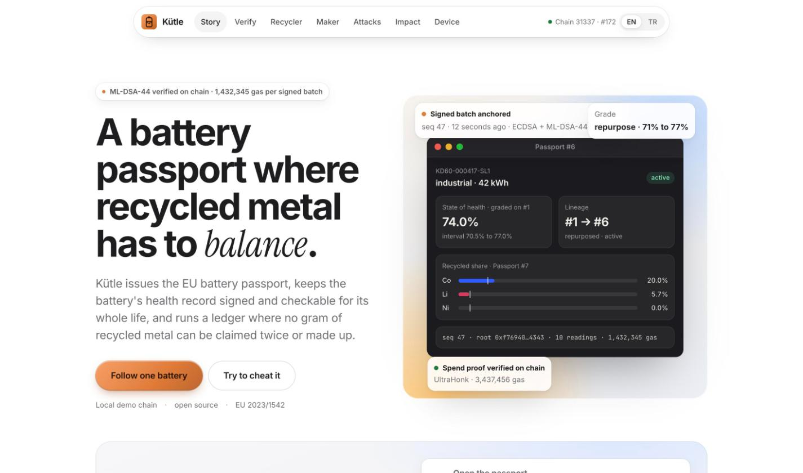
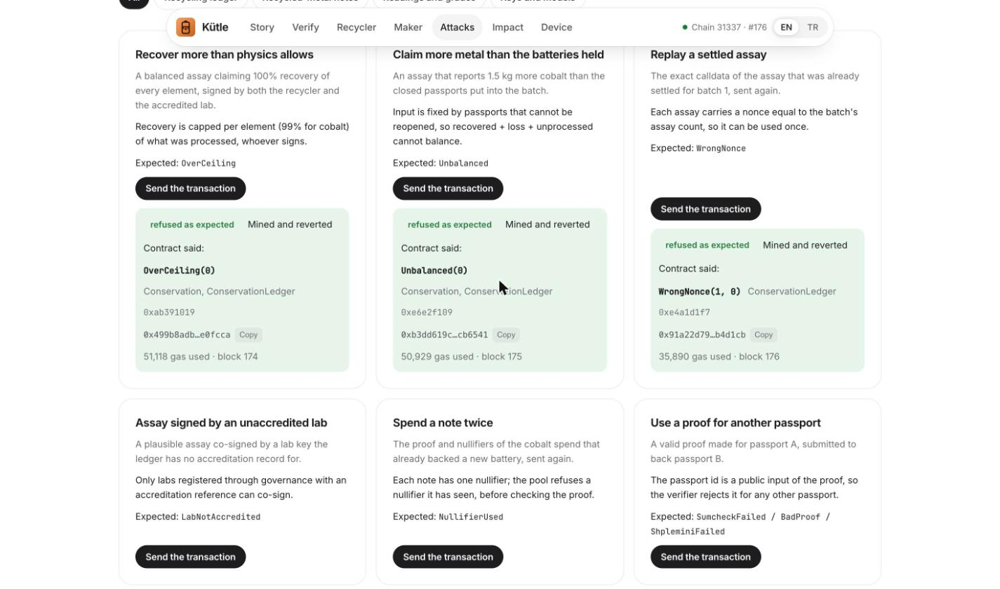

# Kütle

Like a car's service history, but for EV batteries, and impossible to fake. Good batteries get a second life instead of the shredder.

A buyer looking at a used EV battery can't tell a worn pack from a good one, so good packs get shredded. Kütle gives every battery a history nobody can quietly edit.

**Try it live:** [kinnuworks.github.io/kutle/#/verify/1](https://kinnuworks.github.io/kutle/#/verify/1). Your browser checks the real battery in our laptop against Base Sepolia (3 of 3 checks pass, including the post-quantum signature).

- **Climate:** every pack moved from the shredder into a second life avoids building new storage. For the packs of one Turkish factory that is up to 12,000 t CO2 a year by the mid 2030s (scenario, assumptions in [docs/IMPACT.md](docs/IMPACT.md)).
- **Blockchain:** battery readings signed twice (one signature is post-quantum) and checked on chain, a grade the seller can't pick, and a recycling ledger where metal has to add up.
- **AI:** health models trained on public cell data. The contract only accepts a model that proves its accuracy on data it has never seen. Ours haven't passed yet, so we kept the rule and published the numbers.
- **Try to cheat it:** 12 attacks, each sent as a real transaction and refused with the contract's reason.

## Live on Base Sepolia

- **App:** https://kinnuworks.github.io/kutle/ (check passport #1 yourself: https://kinnuworks.github.io/kutle/#/verify/1)
- **All 12 contracts verified on Sourcify.** For example ReadingLog [0xFcf673…75E0](https://sepolia.basescan.org/address/0xFcf673B7745b3c17BDB42d3f32634264941f75E0) and ConservationLedger [0x6d3beF…f787](https://sepolia.basescan.org/address/0x6d3beFF5F26D397c29AF0EDA0312D6808AF8f787). Full list in [contracts/deployments/84532.json](contracts/deployments/84532.json).
- **Device registered**, both proofs of possession checked on chain (ECDSA and ML-DSA-44): [tx](https://sepolia.basescan.org/tx/0xc1853759029c1c295eac19ea997403e662e4ac0b203cd45ba1a4523346013b91)
- **Real readings from the battery in our laptop** (170 cycles, 4,394 of 4,629 mAh), signed twice and anchored, 1.47M gas: [tx](https://sepolia.basescan.org/tx/0x4fa76c81caaf790e677589739f0b58e79bfc4cad1d6ec2205a03e28aa5bc957c)
- **The same batch replayed, refused** with `BadSequence(1, 0)`: [tx](https://sepolia.basescan.org/tx/0x59bbae2ce03ffd8b4900a55a05c0d7d0475fb8dfe5b5911fd436e47bb6d5788c)

The full demo story (recyclers, assays, private recycled-content proofs and all 12 attacks) runs on a local chain with one command, `pnpm dev:chain` in `app/`, because it replays 430 days of history.

IEEE ClimateChain Global Hackathon 2026 · Track 3, Sustainable supply chains and circular economy (also touches Track 2, second-life storage, and Track 4, signed sensor data).

From 18 February 2027 every EV, light-vehicle and industrial battery sold in the EU needs a digital passport (Regulation (EU) 2023/1542). From 2031 battery makers must also meet minimum shares of recycled cobalt, lithium, nickel and lead. Kütle issues the passport, keeps the battery's health history honest for the ten-plus years a passport must survive, decides whether a used pack should get a second life or go to recycling, and runs a ledger in which no gram of recycled metal can be counted twice or created out of nothing.

*Kütle* is Turkish for mass.



## In plain words

- **A battery's health record that nobody can quietly edit.** A small chip next to the battery signs its readings with a signature built to resist future quantum computers, and the blockchain checks it.
- **Recycled metal that has to add up.** A recycler can only claim metal from batteries it really took in, and never more than physics allows. The same kilogram can't be counted twice.
- **Suppliers stay private.** A battery maker proves it used enough recycled metal without revealing who sold it.

We tried to cheat every rule. The app's attack console sends those attempts as real transactions, and each one is refused with the reason shown:



## Judge guide: every requirement and where it is

| Requirement | Where | Status |
|---|---|---|
| Working prototype | Live on Base Sepolia (app and verified contracts, see above); full story on a seeded local chain (`pnpm dev:chain` in `app/`) | Deployed and verified; real laptop readings anchored on testnet |
| Source code with documentation | this repository | Public |
| Architecture diagram and technical specification | [docs/ARCHITECTURE.md](docs/ARCHITECTURE.md), [docs/architecture.svg](docs/architecture.svg) | Done |
| 3-minute video | link in the Devpost entry; script in [docs/VIDEO_SCRIPT.md](docs/VIDEO_SCRIPT.md) | Script ready; the recording is linked from the Devpost entry |
| Security and data-integrity assessment | [docs/SECURITY.md](docs/SECURITY.md) | Done |
| Problem statement and solution overview, 2 pages | [docs/BRIEF.md](docs/BRIEF.md) | Done |
| Climate impact assessment with projections | [docs/IMPACT.md](docs/IMPACT.md) | Done, sourced, assumptions labelled |
| Implementation and adoption strategy | [docs/ADOPTION.md](docs/ADOPTION.md) | Done |
| Scalability and sustainability roadmap | [docs/ROADMAP.md](docs/ROADMAP.md) | Done |
| User testing results | [docs/USER_TESTING.md](docs/USER_TESTING.md) | Protocol ready; results from a session with a battery professional will be added here once it takes place |

| Weighted criterion | Evidence |
|---|---|
| Climate impact (30%) | Avoided emissions booked on chain at every second life; per pack 0.37 to 1.13 t CO2e allocated; recycled metal counted once, as the 2031 rules require ([IMPACT.md](docs/IMPACT.md)) |
| Technical innovation and blockchain (30%) | ML-DSA-44 verified on chain, conservation ledger with an exact per-element equality, private recycled-content proofs (Noir, UltraHonk) verified on chain |
| Feasibility (10%) | Firmware builds for ESP32-S3; real readings from a laptop battery; gas measured for every operation |
| Data security and transparency (10%) | 112 tests, invariant fuzzing, Halmos proofs, 20 of 20 mutants killed, a registry that refused all three of our own health methods |
| User experience (10%) | Turkish and English app, one-battery story, attack console of real failing transactions |
| Scalability and sustainability (10%) | Batched signatures, L2 costs, council and timelock governance, open standards ([ROADMAP.md](docs/ROADMAP.md)) |

## Judge path, 90 seconds

1. Open the app (link below) and press **Follow one battery**. It walks one real pack, the battery in the laptop this was built on, from signed gauge readings to a grade, a second life and recycling.
2. Press **Try to cheat it**. Each card sends a real transaction that fails, with the contract's reason shown.
3. Open [docs/SECURITY.md](docs/SECURITY.md) section 2 for what the system trusts and how each assumption is enforced.

## What is in the box

| Part | What it does | Status |
|---|---|---|
| Device signing | An ESP32-S3 next to the battery's fuel gauge signs every batch of readings with secp256k1 and ML-DSA-44 (FIPS 204). Both signatures are verified on chain | Firmware builds; host tests match the TypeScript gateway byte for byte; the laptop gateway anchors real readings from this MacBook's battery |
| On-chain ML-DSA | Real post-quantum signature checks in Solidity, with the key-registration safeguards the verifier's safety report requires (degeneracy floor on chain, key de-duplication, code-hash pinning, proof of possession) | Tested with real keys and signatures |
| Health model | State of health with an interval and remaining cycles, trained on public cell-ageing data and tested once on a dataset it never saw | All methods beat the baseline; none yet meets the registry's 85% coverage rule, so none is registered ([model/README.md](model/README.md)) |
| Passports | On-chain core of the Battery Pass record (DIN DKE SPEC 99100): metal content, recycled content, health grades, lineage, revocation | Grade computed on chain from the interval |
| Conservation ledger | For every metal of every recycler batch: input = recovered + loss + unprocessed, recovery capped per pass, input fixed by closed passports, co-signed EIP-712 assays | Unit tests, invariant fuzzing, symbolic proofs |
| Private recycled content | Recovered metal becomes notes in a Poseidon2 tree; a maker proves in zero knowledge (Noir, UltraHonk) that it owns enough to back a new battery. The share is public; the suppliers are not | Real proof verified on chain in the tests |
| Governance | 2-of-3 council behind a timelock; the deployer renounces every role at deploy time | Tested |
| App | Passport viewer, verifier, recycler and maker consoles, attack console, impact page, Turkish and English | See [app/README.md](app/README.md) |

## Why each cryptographic piece is there

- **ML-DSA on every reading batch:** a passport must stay checkable for years after the battery is recycled, longer than ECDSA can be trusted. A forged health history could pass a worn pack off as healthy.
- **Merkle roots:** one ML-DSA verification costs about 1.2M gas, so the device signs a root over many readings, and any single reading can be proven later.
- **The ledger:** four parties with opposed interests (maker, second-life operator, recycler, next maker) touch the same battery, and the record must outlive all of them.
- **Zero knowledge:** the law makes the recycled share public. Makers treat their recycler relationships as trade secrets. The proof gives both.

## Numbers

| | |
|---|---|
| Contract tests | 112 passing (unit, fuzz, invariant, real ML-DSA and UltraHonk proofs) |
| Symbolic proofs | Conservation for every input, grading soundness and monotonicity (Halmos) |
| Mutation testing | 20 of 20 deliberately broken rules caught by the suite |
| Gas | device registration 2.73M, reading batch 2.47M, note mint 0.88M, private spend 4.84M |
| Proof | 13,384 UltraHonk gates, about 230 ms in the browser, 8 KB |
| Signatures | ML-DSA-44: 1,312-byte public key, 2,420-byte signature |

## Documents

| Required deliverable | File |
|---|---|
| Problem statement and solution overview (2 pages) | [docs/BRIEF.md](docs/BRIEF.md) |
| Architecture diagram and technical specification | [docs/ARCHITECTURE.md](docs/ARCHITECTURE.md) |
| Security and data-integrity assessment | [docs/SECURITY.md](docs/SECURITY.md) |
| Climate impact assessment and carbon reduction projections | [docs/IMPACT.md](docs/IMPACT.md) |
| Implementation and adoption strategy | [docs/ADOPTION.md](docs/ADOPTION.md) |
| Scalability and sustainability roadmap | [docs/ROADMAP.md](docs/ROADMAP.md) |
| User testing results | [docs/USER_TESTING.md](docs/USER_TESTING.md) |
| 3-minute video | link below |

## Run it

```bash
git clone --recursive https://github.com/kinnuworks/kutle && cd kutle
```

Contracts (Foundry):

```bash
cd contracts && forge test
```

Symbolic proofs (Halmos):

```bash
cd contracts && halmos --contract SymbolicTest
```

Circuit (Noir 1.0.0-beta.22):

```bash
cd circuits/shielded_spend && nargo test
```

Device gateway and provisioning:

```bash
cd device && pnpm install && node --test gateway/test/
```

Firmware host tests:

```bash
cd device/firmware && pio test -e native
```

Model:

```bash
cd model && python -m pytest -q
```

App on a local chain with a seeded demo story:

```bash
cd app && pnpm install && pnpm dev:chain
```

## What is real and what is simulated

Real: ML-DSA-44 and ECDSA signatures checked on chain, the UltraHonk proof checked on chain, the laptop battery's gauge readings, the health model's evaluation on public data, all contract rules. Simulated: the testnet role keys, the lab's accreditation reference, the recycler batches and assay numbers in the demo. The demo battery is a laptop pack, which the passport mandate does not cover; the pipeline is the one an EV or industrial pack would use. Full list in [docs/SECURITY.md](docs/SECURITY.md) section 4.

## Credits

Built on open work by others: the ML-DSA-44 verifier by Fireblocks Labs (MIT), Poseidon2 for the EVM by zemse (MIT), mldsa-native from the PQ Code Package, bitcoin-core/secp256k1, Noir and Barretenberg by Aztec, OpenZeppelin Contracts, Foundry, Halmos by a16z, and the Battery Pass data model by the Battery Pass consortium. Cell-ageing data from NASA, CALCE and Severson et al. (see [model/data/SOURCES.md](model/data/SOURCES.md)).

## License

MIT
