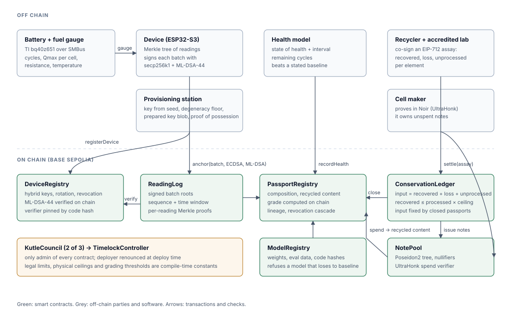

# Architecture and technical specification

## Components

| Layer | What it is | Where |
|---|---|---|
| Device | ESP32-S3 next to the battery's fuel gauge. Reads the gauge over SMBus (or is fed readings by the laptop gateway in the demo), builds Merkle trees of readings, signs each batch with secp256k1 and ML-DSA-44 | `device/firmware`, `device/gateway` |
| Provisioning | Key ceremony: derives keys from a seed, checks the public key against the seed, runs the degeneracy floor, builds the verifier blob, registers the device | `device/provision`, `tools/mldsa` |
| Health model | Gradient-boosted state-of-health and remaining-life model with conformal prediction intervals, trained on public cell-ageing data | `model/` |
| Contracts | Device keys, reading log, passports, model registry, conservation ledger, note pool, governance | `contracts/src` |
| Zero-knowledge | Noir circuit for private recycled-content spends, UltraHonk verifier generated by Barretenberg | `circuits/shielded_spend`, `contracts/src/verifiers` |
| App | Passport viewer, verifier, recycler and maker consoles, attack console, impact page, in Turkish and English | `app/` |

## Contracts

| Contract | Responsibility | Key checks |
|---|---|---|
| `DeviceRegistry` | Hybrid device keys, rotation, revocation, pluggable signature suites | Key length, centred-lift floor, de-duplication on the canonical key, blob and verifier pinned by code hash, proof of possession with both keys |
| `ReadingLog` | Merkle roots of signed reading batches | Both signatures, sequence numbers, forward-moving time windows, device bound to an active passport |
| `ModelRegistry` | Health model versions with hashes of weights, evaluation data and code | Refuses a model that does not beat its baseline or covers under 85% |
| `PassportRegistry` | On-chain core of the battery passport: composition, recycled content, health, lineage, status | Grade computed on chain from the interval; repurposing needs a fresh grade; one-way closure at a recycler; revocation cascades |
| `ConservationLedger` | Recycler batches, co-signed assays, issuance of recovered metal | `input = recovered + loss + unprocessed` per element; `recovered ≤ processed × ceiling` per pass; EIP-712 with nonce and deadline; taint on revocation |
| `NotePool` | Poseidon2 Merkle tree of recycled-metal notes; private spends | Known root, unused and distinct nullifiers, UltraHonk proof over ten public inputs, operator-only |
| `KutleCouncil` + `TimelockController` | Governance | 2 of 3 members, timelock delay, deployer renounced |

Libraries: `Elements` (legal and physical constants), `Conservation` (the assay arithmetic, proven with Halmos), `MLDSAKey` (on-chain key checks).

## Data flow

1. **Provisioning.** The station generates a seed, derives both keys, checks the ML-DSA public key against the seed and against the centred-lift floor, deploys the 20,545-byte key blob and calls `registerDevice` with proof-of-possession signatures from both keys.
2. **Issuance.** The manufacturer issues a passport bound to the device. The full Battery Pass record (DIN DKE SPEC 99100 data model) is stored off chain; its SHA-256 and a GS1 Digital Link identifier go on chain with the metal content per element.
3. **Life.** The device samples the gauge, groups readings into batches, builds a Merkle tree (leaf = keccak256(keccak256(record)), sorted pairs) and signs the batch digest with both keys. Anyone can relay the batch to `ReadingLog.anchor`. Any single reading can later be proven against its batch root.
4. **Grading.** The grader runs the registered model on the anchored readings and submits state of health with an interval and remaining cycles. The contract computes the grade.
5. **Second life.** With a fresh reuse or repurpose grade, a repurposer creates a child passport linked to the parent. The contract books the avoided manufacturing emissions for the retained capacity.
6. **Recycling.** A recycler opens a batch and feeds end-of-life passports into it, closing them for good. A co-signed assay splits the input into recovered metal, loss and unprocessed stock.
7. **Recycled metal.** The recycler issues recovered metal as notes to buyers' commitments. A cell maker proves in zero knowledge that it owns notes worth the declared grams and spends them into a new passport's recycled content.

## Encodings

| Item | Encoding |
|---|---|
| Device batch digest | `keccak256(abi.encode(BATCH_TYPEHASH, chainid, readingLog, deviceId, passportId, seq, root, fromTs, toTs, count))` |
| ECDSA over a digest | EIP-191 personal sign of the 32-byte digest |
| ML-DSA over a digest | FIPS 204 ML-DSA-44, pure signing, empty context, message = the 32 raw digest bytes |
| Reading leaf | `keccak256(keccak256(abi.encode(reading fields)))`, see `device/SPEC.md` |
| Assay | EIP-712, domain "Kutle ConservationLedger" version 1 |
| Note leaf | `Poseidon2(element, grams, ownerCommit)`, `ownerCommit = Poseidon2(secret, salt, 1)`, `nullifier = Poseidon2(secret, salt, 2)` |
| Note tree | Poseidon2 (BN254, t = 4), depth 16, empty leaf 0, last 64 roots accepted |
| Spend public inputs | root, element, passportId, declaredGrams, nullifier[4], changeLeaf, binding |

## Gas (measured in the test suite)

| Operation | Gas |
|---|---|
| Register a device (floor check, two proofs of possession) | 2.73M |
| Anchor a reading batch (ECDSA + ML-DSA-44) | 2.47M |
| Mint a recycled-metal note (16 Poseidon2 hashes) | 0.88M |
| Private spend with change (UltraHonk verification) | 4.84M |

On Base Sepolia, an L2, these costs are small fractions of a cent at current prices, and they fit under the 16.7M per-transaction cap that Ethereum introduced with EIP-7825.

## Why a blockchain here

Four parties with opposed interests touch the same battery: the manufacturer (wants high recycled shares), the second-life operator (wants a good grade), the recycler (wants to sell more recovered metal) and the next manufacturer (wants cheap compliance). The passport must outlive any of them for at least ten years. A shared ledger with enforced rules lets each party rely on the others' records without trusting their databases: no battery is counted twice, no metal appears from nowhere, and no history can be rewritten later.
